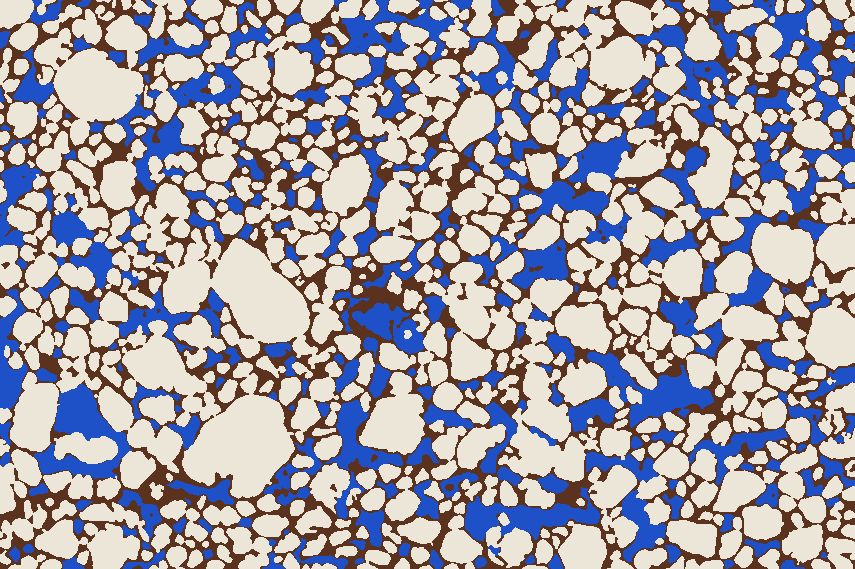
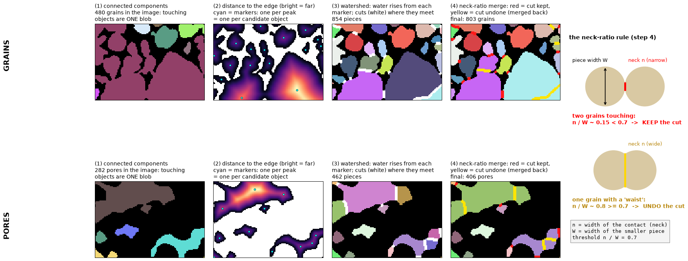
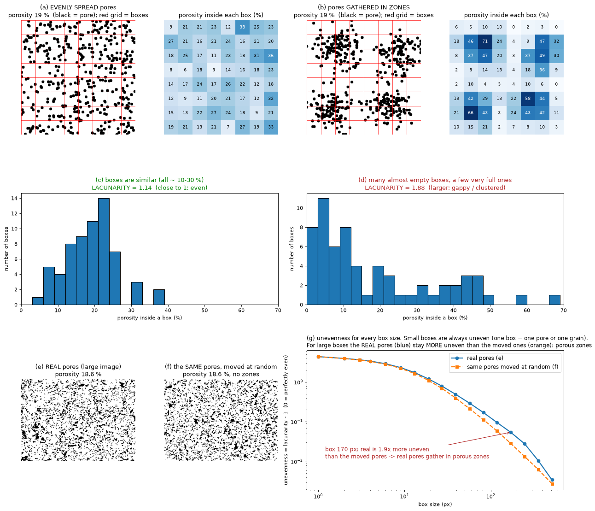

# Image analysis of a sandstone thin section

Exercise 1 of *Reservoir Geological Characterization* (2026): porosity, grains, pores, heterogeneity and grain shape
measured from two photographs of a blue-epoxy-impregnated sandstone thin section, solved in Python as an
image-processing problem.

<p align="center">
  <br>
  <em>Every pixel classified as grain (cream), pore (blue) or cement (brown) – notebook 01.</em>
</p>

## Results at a glance

| Question | Answer | Notebook |
|---|---|---|
| **Task 1** – how much pore, grain and cement? | porosity **~ 19 %** (range 16–19 %), grain ~ 57 %, cement ~ 23 % | [01](notebooks/01_three_phase_segmentation.ipynb) |
| **Task 2** – how large must a sample be? (REV) | **~ 360 Lpx** for porosity within ±20 %, **~ 800 Lpx** within ±10 % (predicted) | [04](notebooks/04_heterogeneity.ipynb) |
| **Task 3** – individual grains | **803** grains (small image), **3,739** (large image) | [02](notebooks/02_pore_and_grain_objects.ipynb) |
| **C1** – are pores spread evenly? | no: pores gather in **porous zones ~ 150–250 Lpx** across (10–15 grains); local porosity follows **cement**, not grain size or sorting | [04](notebooks/04_heterogeneity.ipynb) |
| **C2** – individual pores | **406** pore bodies (small image), **1,751** (large image), cut at the pore throats | [02](notebooks/02_pore_and_grain_objects.ipynb) |
| **C3** – area and size of each object | median grain diameter **13.8 Lpx**, moderately well sorted (0.69 φ); the largest 10 % of pores hold 38 % of the pore area | [03](notebooks/03_areas_and_size_distributions.ipynb) |
| **C4** – data for Fourier analysis | 64 radii and 24 harmonics for **760 grains**; harmonics 2–14 are reliable; one shape population, mainly elongated | [05](notebooks/05_fourier_grain_shape.ipynb) |

Lpx = one pixel of the large image (the common size unit of the project; the photographs have no scale bar).

## How it works

```
photograph ──► 01 pixel classes ──► 02 separate objects ──► 03 sizes and shapes
                (grain/pore/cement)    (grains, pore bodies)      (areas, sorting, throats)
                        │                                             │
                        └──────────► 04 REV and heterogeneity ◄───────┘
                                     05 grain shape (Fourier)
```

1. **Pixel classification** (01). Colors are converted to CIELAB: grains are bright (Otsu threshold on lightness),
   pores are blue (hue −140 to −40°, chroma > 5), cement is the rest; tiny specks are cleaned up.
2. **Object separation** (02). Distance to the edge → one marker per object → watershed → cuts at wide "waists"
   undone (neck ratio). Cross-checked with PoreSpy SNOW.

   

3. **Measurements** (03). Area, equivalent diameter, Folk & Ward sorting, pore throats and shape descriptors; the two
   images are put in one unit (Lpx) by template matching.
4. **REV and heterogeneity** (04). Random windows (REV), two-point correlation, integral range, lacunarity against
   randomized images, Clark-Evans and Ripley point-pattern tests, Spearman correlations on 88 blocks.

   

5. **Grain shape** (05). Radius-versus-angle Fourier harmonics and elliptic Fourier descriptors, a resolution test
   with the two photographs, PCA and clustering of shapes, and a test for a preferred grain direction.

## Reading the notebooks

Every notebook follows the same pattern, so it can be read without knowing the code:

- **The question** – what the section is about;
- **Why it matters** – what the result is used for;
- **What / How** – the method in plain words, often with an explanatory figure;
- **Reading the result** – after every plot or table: the axes, what to look for, and the numbers;
- **Findings** – a summary at the end of each notebook.

Notebook 01 starts with a project overview: where each task is solved, the output files and the main results.

## Repository layout

| Folder | Content |
|---|---|
| `notebooks/` | the five analysis notebooks (01–05), saved with their results |
| `src/` | shared code: `segmentation.py` (pixel classes), `objects.py` (splitting and measuring objects), `sizestats.py` (size statistics), `heterogeneity.py` (REV, correlation, lacunarity, point patterns), `shape.py` (Fourier shape), `figstyle.py` (figure style) |
| `scripts/` | scripts that draw the explanatory figures into `outputs/figures/` |
| `outputs/` | tables (CSV), label maps (`.npy`), phase maps and figures produced by the notebooks |

## Running it

```bash
pip install -r requirements.txt
```

The two thin-section photographs of the course (`Lamina_alunos2.png` and `Lamina_alunos_grande.png`) are **not
included**. Place them in the repository root, then run the notebooks in order 01 → 05; each one reads the outputs
of the previous ones. The scripts in `scripts/` redraw the explanatory figures (run them from the repository root).

## Glossary

| Term | Meaning |
|---|---|
| **Phase** | one of the three materials: grain, pore (blue epoxy) or cement |
| **Lpx** | one pixel of the large image; the small image is converted to it (1 small-image pixel = 0.839 Lpx) |
| **Pore body / throat** | a pore body is one separate pore; a throat is the narrow passage where two pore bodies meet |
| **REV** | Representative Elementary Volume: the smallest sample whose porosity no longer depends on where it is taken |
| **CV** | coefficient of variation (standard deviation / mean): the typical relative error of one sample |
| **Correlation length** | the distance over which two points still "know" about each other (~ 6 Lpx for pores) |
| **Integral range (A3)** | the area of one statistically independent unit of the rock (~ 19 × 19 Lpx for pores) |
| **Lacunarity** | how uneven the pore content of boxes of a given size is (1 = all boxes alike) |
| **CSR** | complete spatial randomness: points placed purely at random, the reference of the point-pattern tests |
| **Clark-Evans R** | mean nearest-neighbor distance / the value for random points (R > 1 regular, R < 1 clustered) |
| **Ripley L(r) − r** | neighbor count within distance r, rescaled so that random points give 0 |
| **Spearman ρ** | rank correlation from −1 (one goes up, the other down) to +1 (they go up together); 0 = unrelated |
| **Harmonic n / amplitude A_n** | a wave with n bumps per turn around a grain outline, and how strong it is (fraction of the mean radius) |
| **EFD** | elliptic Fourier descriptors, a Fourier description that works for any closed outline |

## License and author

Code released under the [MIT License](LICENSE). Author: Farith Comas.
